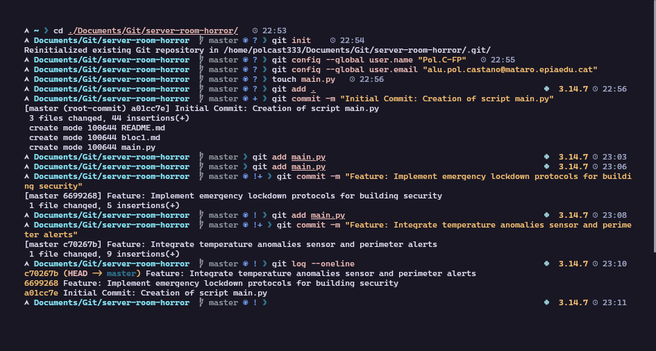

### Acció 3.1: Creació del directori i estructura inicial de Git
Es crea el directori del projecte i s'inicialitza un repositori Git buit per començar el rastreig forense.
```bash
git init
```

### Acció 3.2: Configuració d'identitat
Es configuren les credencials locals de Git per identificar l'enginyer/a forense que realitza les accions.
```bash
git config user.name "Pol.C-FP"
git config user.email "alu.pol.castano@mataro.epiaedu.cat"
```

### Acció 3.3: Generació del fitxer base (1r Commit)
Es crea el fitxer principal `main.py` amb el codi inicial d'encesa del servidor i es registra el primer commit.
```bash
git add .
git commit -m "Initial Commit: Creation of script main.py"
```

### Acció 3.4: Modificacions del sistema de seguretat (2n i 3r Commit)
**2n Commit:** S'afegeix la funció de bloqueig de portes al sistema de seguretat.
```bash
git add main.py
git commit -m "Feature: Implement emergency lockdown protocols for building security"
```

**3r Commit:** S'implementen els sensors de temperatura per a la sala de servidors afectat pel fred paranormal.
```bash
git add main.py
git commit -m "Feature: Integrate temperature anomalies sensor and perimeter alerts"
```

### Acció 3.5: Consulta de l'historial simplificat
Es verifica l'estabilitat de la línia temporal inicial mostrant l'historial en una sola línia.
```bash
git log --oneline
```

