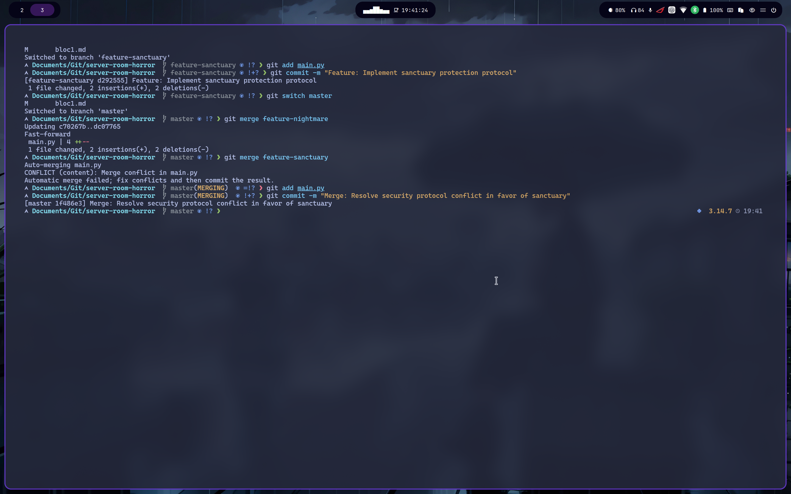

### Acció 3.6: Creació de les branques del Més Enllà
Es creen dues branques independents a partir de `main` per desenvolupar les dues versions del sistema de seguretat sense modificar directament la branca principal. Primer, es defineix una línia comuna que servirà de punt de partida.
```bash
git branch feature-nightmare
git branch feature-sanctuary
git branch
```

**Justificació:** Les dues branques es creen a partir de `main` perquè comparteixin el mateix punt d'origen i puguin evolucionar de manera independent. Així, es poden comparar les dues versions i provocar un conflicte en fusionar-les.

### Acció 3.7: Implementació de la dimensió fosca (Commit)
Es canvia a la branca `feature-nightmare` i es modifica la línia del protocol de seguretat del fitxer `main.py` per activar la lògica de la dimensió fosca.
```bash
git switch feature-nightmare
git add main.py
git commit -m "Feature: Implement nightmare security protocol"
```

### Acció 3.8: Implementació de la protecció del santuari (Commit)
Es canvia a la branca `feature-sanctuary` i es modifica exactament la mateixa línia del fitxer `main.py`, establint el protocol de protecció del santuari.
```bash
git switch feature-sanctuary
git add main.py
git commit -m "Feature: Implement sanctuary protection protocol"
```

### Acció 3.9: Integració de les branques a la línia principal
Es torna a la branca `master` i s'integra primer `feature-nightmare`. A continuació, s'intenta fusionar `feature-sanctuary`, fet que provoca un conflicte perquè les dues branques han modificat la mateixa línia de codi.
```bash
git switch master
git merge feature-nightmare
git merge feature-sanctuary
```

### Acció 3.10: Resolució del conflicte i fusió definitiva (Commit de fusió)
S'analitza el conflicte generat al fitxer `main.py` i s'identifiquen les marques que Git ha introduït per separar les dues versions del codi.
```bash
git status
nano main.py
```

El conflicte mostra les dues versions incompatibles de la mateixa línia:
```python
<<<<<<< HEAD
    print("[NIGHTMARE]: Activant protocol de tancament d'emergència...")
    print("[NIGHTMARE]: Totes les sortides de l'edifici han estat segellades.")
=======
    print("[SANCTUARY]: Activant protocol de tancament d'emergència...")
    print("[SANCTUARY]: Totes les sortides de l'edifici han estat segellades.")
>>>>>>> feature-sanctuary
```

Es decideix conservar el protocol de protecció `SANCTUARY` per garantir la seguretat del servidor. S'eliminen manualment les marques del conflicte i es deixa la línia definitiva:
```python
    print("[SANCTUARY]: Activant protocol de tancament d'emergència...")
    print("[SANCTUARY]: Totes les sortides de l'edifici han estat segellades.")
```

Finalment, es registra la resolució del conflicte i es comprova l'historial complet de les fusions.
```bash
git add main.py
git commit -m "Merge: Resolve security protocol conflict in favor of sanctuary"
```


