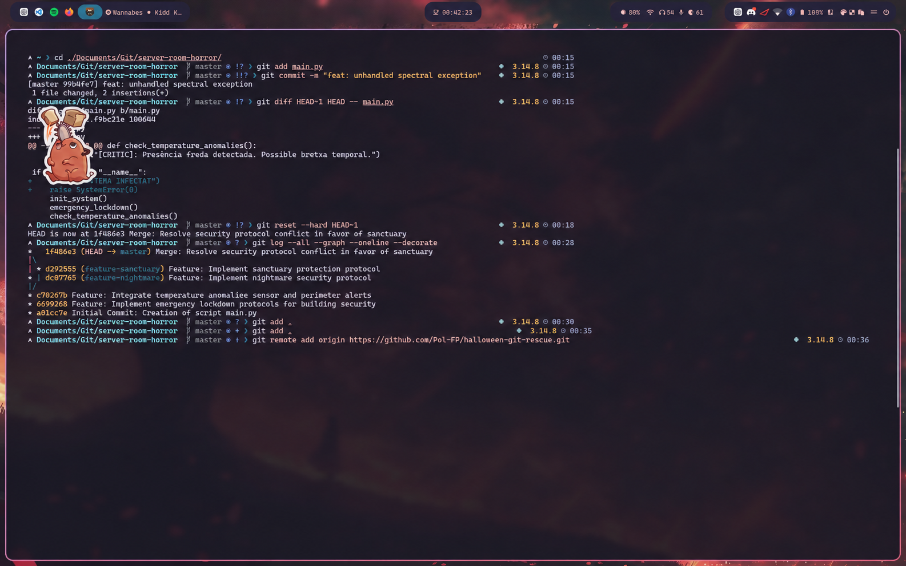

### Acció 3.11: Infecció del sistema (Commit defectuós)
Es modifica el fitxer `main.py` per introduir una excepció que simula la corrupció del sistema provocada per l'esperit maligne. Es registra aquest estat defectuós a l'historial.
```bash
git add main.py
git commit -m "feat: unhandled spectral exception"
```

S'afegeix al fitxer `main.py` la següent instrucció per provocar una excepció:

```python
print("SISTEMA INFECTAT")
raise SystemError(0)
```

### Acció 3.12: Inspecció de les diferències temporals
S'analitzen les diferències entre el commit infectat actual (`HEAD`) i el commit anterior (`HEAD~1`), que representa l'últim estat segur del sistema. Això permet identificar exactament el codi maliciós introduït.

```bash
git diff HEAD~1 HEAD -- main.py
```

### Acció 3.13: Reversió temporal i eliminació de la infecció
Es restaura el repositori al commit anterior mitjançant `git reset --hard HEAD~1`, eliminant els canvis del commit infectat de l'espai de treball i retirant aquest commit de l'historial de la branca principal.

```bash
git reset --hard HEAD~1
```

### Acció 3.14: Verificació de la topologia final del repositori
Es visualitza l'historial complet en format gràfic per comprovar les branques creades, els commits realitzats i la fusió definitiva. També es verifica que la branca principal ha recuperat l'estat segur anterior a la infecció.

```bash
git log --all --graph --oneline --decorate
```

### Acció 3.15: Publicació del repositori a GitHub
Es crea un repositori públic a GitHub amb el nom `halloween-git-rescue` per publicar el projecte i permetre'n l'auditoria final.

Abans de publicar-lo, s'afegeixen els fitxers de documentació Markdown i les captures de pantalla al repositori local.

```bash
git add .
git commit -m "Docs: Add forensic investigation report and terminal evidence"
```

A continuació, es vincula el repositori local amb el repositori remot de GitHub i es publica la branca principal.

```bash
git remote add origin https://github.com/Pol-FP/halloween-git-rescue.git
git push -u origin master
```

Finalment, es publiquen les branques de desenvolupament per conservar les dues línies temporals i permetre al docent comprovar el procés complet de ramificació i fusió.

```bash
git push origin --all
git remote -v
git branch -a
```

